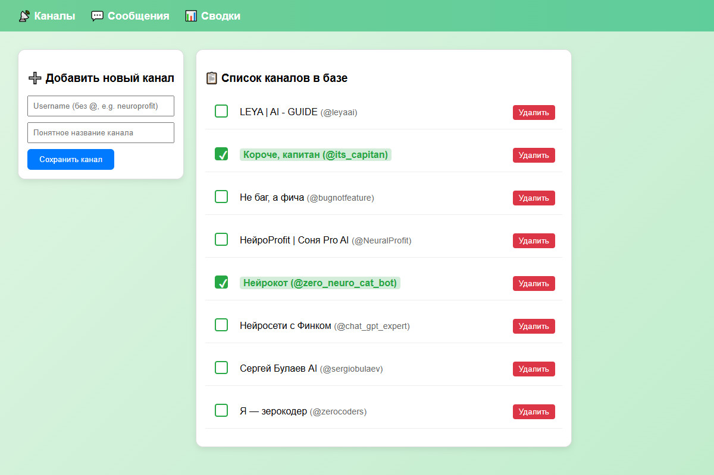
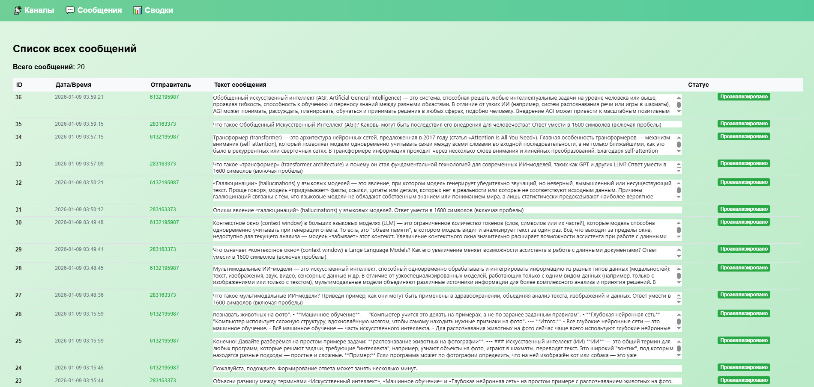
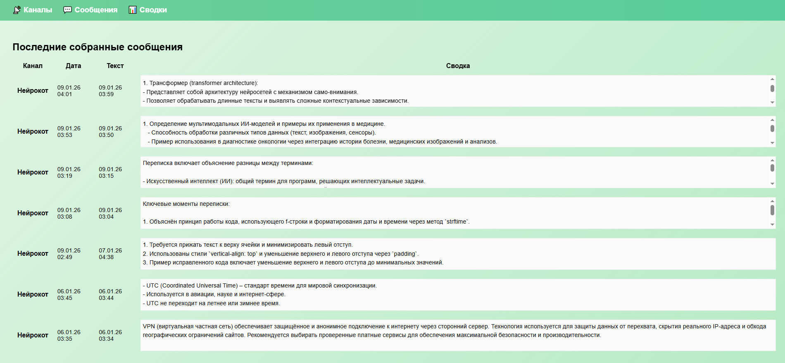

# AI-Tg-Live-Listener

Веб-приложение на Flask для автоматического мониторинга Telegram-каналов и генерации аналитических сводок с помощью GigaChat.

Позволяет одновременно отслеживать несколько каналов, сохранять сообщения в базу данных и управлять процессом через удобный веб-интерфейс. Сводки создаются по новым сообщениям с помощью GigaChat API.

## Возможности

- Мониторинг нескольких Telegram-каналов в реальном времени (Telethon)
- Сохранение сообщений в SQLite
- Веб-панель управления каналами (добавление, включение/выключение мониторинга, удаление)
- Просмотр последних сообщений
- Генерация аналитических сводок через GigaChat
- Telegram-бот с командой `/summary` для быстрого создания сводки
- Периодическое обновление списка отслеживаемых каналов

## Структура проекта

```
AI-Tg-Live-Listener/
├── .env
├── tg_monitor.db
├── bot/
│   ├── __init__.py
│   ├── bot.py                 # Telegram-бот (команды /start, /summary)
│   ├── gigachat.py            # Клиент GigaChat API
│   ├── summary_service.py     # Логика разбиения на чанки и суммаризации
│   └── utils.py
└── tg_listener/
    ├── __init__.py
    ├── db.py                  # SQLAlchemy модели и работа с БД
    ├── listener.py            # Telethon-слушатель новых сообщений
    ├── main.py                # Flask-приложение + запуск листенера
    ├── templates/
    │   ├── base.html
    │   ├── channels.html
    │   ├── messages.html
    │   └── summary.html
    └── static/
        └── style.css
```

## Требования

- Python 3.10+
- Аккаунт Telegram (API ID и API Hash с https://my.telegram.org)
- Аккаунт GigaChat (CLIENT_ID и CLIENT_SECRET)
- Токен бота от [@BotFather](https://t.me/BotFather)

## Установка

1. Клонируйте репозиторий:

```bash
git clone https://github.com/your-username/AI-Tg-Live-Listener.git
cd AI-Tg-Live-Listener
```

2. Создайте виртуальное окружение и установите зависимости:

```bash
python -m venv venv
source venv/bin/activate   # Windows: venv\Scripts\activate
pip install -r requirements.txt
```

> **Примечание:** файл `requirements.txt` в репозитории отсутствует — создайте его самостоятельно (пример ниже).

Пример `requirements.txt`:

```
flask==3.1.3
hypercorn==0.17.3
python-dotenv==1.2.4
sqlalchemy==2.1.8
aiosqlite==0.22.1
telethon==1.45.0
pyTelegramBotAPI==4.37.1
aiohttp==3.14.5
urllib3==2.8.0
pytz==2026.5
chardet==7.7.0
```

3. Создайте файл `.env` в корне проекта:

```env
# Telegram API (https://my.telegram.org)
TG_API_ID=12345678
TG_API_HASH=your_api_hash
TG_SESSION_NAME=tg_listener

# Telegram Bot
BOT_TOKEN=123456:ABC-DEF...

# GigaChat
CLIENT_ID=your_client_id
CLIENT_SECRET=your_client_secret_base64

# Flask
FLASK_SECRET_KEY=your_random_secret_key
```

4. Запустите основное приложение (веб-панель + листенер):

```bash
cd tg_listener
python main.py
```

Панель управления будет доступна по адресу: [http://127.0.0.1:5000](http://127.0.0.1:5000)

5. (Опционально) Запустите Telegram-бота в отдельном терминале:

```bash
cd bot
python bot.py
```

## Использование

### Веб-интерфейс

1. Откройте http://127.0.0.1:5000
2. Добавьте канал (username без `@` и название)
3. Включите мониторинг нужных каналов (кнопка toggle)
4. Сообщения начнут сохраняться автоматически
5. Просматривайте сообщения и историю сводок на соответствующих страницах

### Скриншоты интерфейса

**Форма добавления канала и выбор каналов для мониторинга**



**Список собранных сообщений**



**Список сгенерированных сводок**



### Telegram-бот

- `/start` — информация о боте
- `/summary` — создать сводку по первому активному (мониторимому) каналу  
  Берёт до 100 последних несуммаризированных сообщений, отправляет в GigaChat и сохраняет результат.

## Как это работает

1. **Listener** (`listener.py`) подключается к Telegram через Telethon и ловит новые сообщения из каналов, у которых `is_monitored = True`.
2. Сообщения сохраняются в таблицу `messages` (SQLite).
3. По команде `/summary` или через веб-интерфейс берутся несуммаризированные сообщения.
4. `summary_service.py` разбивает текст на чанки (лимит ~10 000 символов), суммаризирует каждый через GigaChat, затем при необходимости делает финальный проход.
5. Результат сохраняется в таблицу `summaries`, а сообщения помечаются как `is_summarized = True`.

## База данных

Используется SQLite (`tg_monitor.db`). Основные таблицы:

| Таблица     | Описание                          |
|--------------|-----------------------------------|
| `channels`   | Каналы (username, title, is_monitored) |
| `messages`   | Сообщения (текст, дата, is_summarized) |
| `summaries`  | Сгенерированные сводки            |

Время хранится как naive datetime в московском часовом поясе.

## Важные замечания

- Для работы листенера аккаунт Telegram должен быть участником/подписчиком отслеживаемых каналов.
- При первом запуске Telethon попросит авторизацию (код из Telegram).
- SSL-проверка для GigaChat отключена (`ssl=False`) — это связано с особенностями их сертификатов.
- Бот берёт **первый** мониторимый канал. Для выбора конкретного канала потребуется доработка.

## Возможные улучшения

- Выбор канала при вызове `/summary`
- Фильтрация сообщений по дате/ключевым словам
- Уведомления о новых сводках
- Поддержка групп и супергрупп
- Экспорт сводок в Markdown/PDF
- Docker-compose для удобного деплоя

## Лицензия

MIT
```